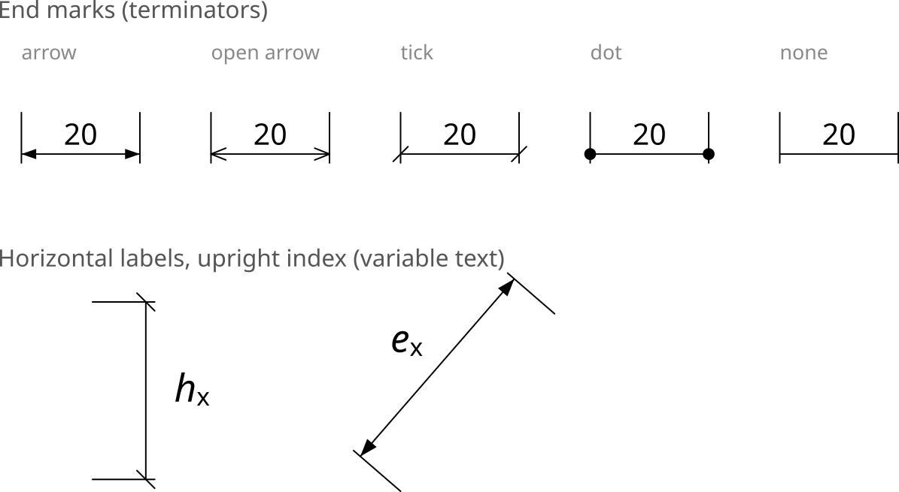
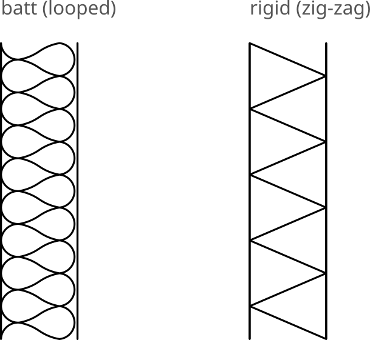
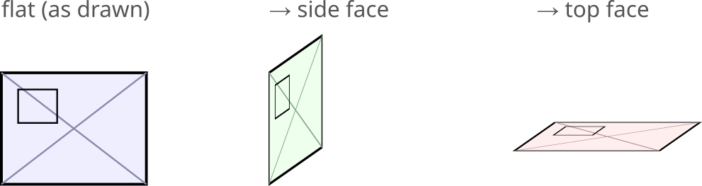

# Inkscape Extensions

**Version 1.0.1** · Custom Inkscape 1.3+ extensions for architectural
drawing, under the **Extensions → Architecture** submenu. See
[CHANGELOG.md](CHANGELOG.md).

| Extension | What it does | Docs |
|-----------|--------------|------|
| **Wall Cavity Insulation** | Fills the space between two wall faces with a batt (looped) or rigid (zig-zag) insulation symbol; follows curved walls. | [README](wall_insulation_README.md) |
| **Dimension Line** | Draws a dimension line between two points (path endpoints or bbox centers) with witness lines, end marks and a distance label; optional variable placeholder with sub/superscript. | [README](dimension_line_README.md) |
| **Axonometric Projection** | Projects flat-drawn faces into oblique axonometry (side / top faces, optionally snapped to the document's axonometric grid). | [README](axo_projection_README.md) |

Install sheet: [English](INSTALLATION_en.md) · [Deutsch](INSTALLATION_de.md).

## Screenshots

**Dimension Line** — end marks and horizontal labels with an upright index:

**Wall Cavity Insulation** — batt (looped) and rigid (zig-zag):

**Axonometric Projection** — flat face → side and top faces:

Each extension is a pair of files:

- `*.inx` — the menu / parameter definition Inkscape reads
- `*.py`  — the effect implementation

## Install

Copy the `.inx` and `.py` files into your Inkscape **user extensions**
folder, then restart Inkscape:

- **Windows:** `%APPDATA%\inkscape\extensions\`
- **Linux:** `~/.config/inkscape/extensions/`
- **macOS:** `~/Library/Application Support/org.inkscape.Inkscape/config/inkscape/extensions/`

See each extension's own README for usage and parameters.

## License

GPL-2.0-or-later — see [LICENSE](LICENSE). Copyright © 2026
Markus Wallner-Novak. (These extensions build on Inkscape's `inkex`
library, which is GPL)
