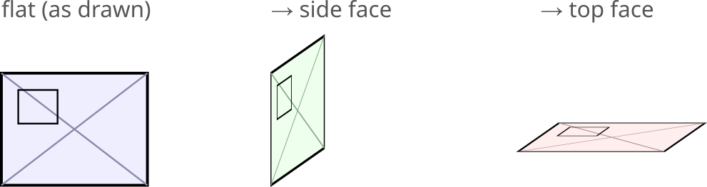

# Axonometric Projection — Inkscape 1.3+ extension

Projects **flat-drawn faces** into axonometry: draw a face true shape,
then shear it onto a coordinate plane. One bbox edge (the joint line)
stays fixed; the matrix is prepended to each selected object's transform.
Two families of modes:

- **Oblique** (`side` / `top`) — one axis stays horizontal, one vertical,
  one recedes. For an **oblique grid** (one grid angle = 0, e.g. Angle X
  0 / Angle Z 35).
- **Isometric** (`iso_right` / `iso_left` / `iso_top`) — *both* in-plane
  axes follow the grid's two diagonals, so the top face is a **rhombus**.
  For a grid where **both angles are non-zero** (e.g. 30/30). Needs the
  grid (reads both angles).

## Install

Copy both files into your Inkscape **user extensions** folder, then
restart Inkscape:

- **Windows:** `%APPDATA%\inkscape\extensions\`
- Linux: `~/.config/inkscape/extensions/`
- macOS: `~/Library/Application Support/org.inkscape.Inkscape/config/inkscape/extensions/`

Files: `axo_projection.inx`, `axo_projection.py`. The tool appears under
**Extensions → Architecture → Axonometric Projection**.

## Use

1. Draw the face flat (true shape) next to the edge it belongs to.
2. Select it (paths or groups).
3. **Extensions → Architecture → Axonometric Projection**.
4. Pick the projection and options, **Apply**.

**Oblique modes** (for an oblique grid, one angle = 0):

- **Side face** — strip drawn to the *right* of a vertical edge; its
  horizontal extent becomes the depth *y* (foreshortened, at the *y*
  angle), verticals stay. Left bbox edge stays put.
- **Top face** — strip drawn *above* a horizontal edge; its upward
  extent becomes the depth *y*, horizontals stay. Bottom bbox edge stays.
- **Undo** modes apply the inverse matrix.

**Isometric modes** (for a grid with both angles non-zero; both read
from the grid, so *Align to document axonometric grid* must be on):

- **iso_right** — x–z face leaning with the right axis (Angle Z).
- **iso_left** — y–z face leaning with the left axis (Angle X).
- **iso_top** — x–y top face as a rhombus using both diagonals.

Draw each face true-shape in the grid's **Spacing Y** unit; the
foreshortening (`1/sin` per axis) makes the corners land on the grid.
The bottom-left corner stays fixed (auto pivot).

## Parameters

| Param | Meaning |
|-------|---------|
| Projection | side / top (and their inverse "undo" variants) |
| Fixed joint line | which selection-bbox edge stays in place (auto picks left for side, bottom for top) |
| x / y length | the tripod ratio — `k = y/x` is the depth foreshortening |
| y angle (°) | angle of the depth axis to the horizontal |
| Align to document axonometric grid | read the grid's angle and foreshortening instead of the tripod (see below) |

## Align to the document's axonometric grid

With **Align to document axonometric grid** ticked, the extension reads
the Inkscape grid (`File → Document Properties → Grids`, type
*Axonometric*) and uses:

- **angle** = the grid's depth angle (`gridanglez` for the side face,
  `gridanglex` for the top; falls back to whichever axis recedes);
- **foreshortening** `k = 1/sin(angle)` — the value that makes one
  drawing-unit of depth rise exactly one grid row (`Spacing Y`), so
  projected corners land on the grid intersections.

Draw the flat face with the **same unit as the grid's Spacing Y**. If
the document has no axonometric grid, the extension stops with a hint.

**Several grids:** if the document has more than one axonometric grid,
the first **enabled** one is used; set **Grid #** to `1`, `2`, … to pick
a specific one.

**Recalculated values pop up in a window:** after running, Inkscape
shows a message listing the grid used and the recalculated **y angle**,
**x length** and **y length** (`k`). An Inkscape effect extension cannot
write those back into the dialog's own fields, so they are reported in
this window instead.

## Notes

- Stroke widths are **not** compensated (the matrix scales them with the
  geometry). Ungrouping later pushes the transform down to the children.
- Works inside transformed groups/layers (the matrix is applied in
  document coordinates).
